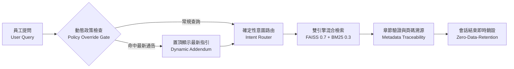

# 🏗️ 企業展示員工手冊智能查詢系統 (EnterpriseDemo-StaffHandbookRAG)

[](https://www.python.org/)
[](https://streamlit.io/)
[](https://www.langchain.com/)
[](./COMPLIANCE_AND_PRIVACY.md)
[](./COMPLIANCE_AND_PRIVACY.md)
[](./LICENSE)

**An AI-powered Enterprise Hybrid RAG Assistant for Corporate Staff Handbooks and HR Policies.**  
專為現代化企業打造之企業級 HR 政策與《員工手冊》智能對答系統（合規展示版本）。

🌐 **專案展示頁 / Live Showcase**: [https://jackylawck.github.io/EnterpriseDemo-StaffHandbookRAG/](https://jackylawck.github.io/EnterpriseDemo-StaffHandbookRAG/)

---

## 📖 項目簡介 / System Overview

**EnterpriseDemo-StaffHandbookRAG** 是一個基於檢索增強生成（RAG, Retrieval-Augmented Generation）技術的企業級政策檢索引擎。系統結合了稠密向量語意檢索與稀疏關鍵字精確比對，協助員工快速定位《月薪員工手冊》及最新人力資源政策通告，並在底層架構中全面貫徹 **「Governance-as-Code（治理即代碼）」** 與 **「Zero-Data-Retention（零數據留存）」** 原則。

**EnterpriseDemo-StaffHandbookRAG** is an enterprise AI assistant designed for corporate employees to query staff handbooks and updated HR policies. Combining semantic search and exact keyword matching, it delivers accurate, traceable, and up-to-date compliance guidance while enforcing strict ephemeral memory processing and zero data retention.

---

## 🔄 系統檢索與治理架構 / Architecture & Governance Pipeline



---

## ✨ 核心特色 / Key Features

* **雙引擎混合檢索 (Ensemble Hybrid Retrieval)**
* 結合 **FAISS（向量語意搜尋，權重 0.7）** 與 **BM25（關鍵字精確比對，權重 0.3）**，兼顧口語化自然提問與精確表單代號（如 `Demo-Form-011`）。
* Integrates **FAISS** and **BM25** via Reciprocal Rank Fusion (RRF) for optimal recall precision across conversational queries and specific form codes.


* **最新政策動態覆蓋 (Dynamic Policy Overriding)**
* 透過外部配置檔 `policy_overrides.json` 掛載最新人事通告（如 2026 人面識別考勤、薪酬架構優化、培訓資助），自動置頂提示新規定，防止舊版手冊條文誤導。
* Dynamically overrides legacy handbook clauses with latest policy addendums, ensuring employees always receive current instructions.


* **確定性章節路由與雜訊過濾 (Deterministic Routing & Noise Sanitization)**
* 內建章節索引樹與正則表達式，強制將特定議題鎖定至權威章節（如「培訓資助」強制錨定第九章），並自動剔除頁首頁尾及過短雜訊片段。
* Enforces rule-based chapter binding and regex chunk cleaning to prevent cross-chapter hallucinations.


* **聲明式治理與數據契約 (Declarative Governance-as-Code)**
* 將檢索管線規則（`flows/`）與政策配置驗證結構（`schemas/`）解耦獨立，大幅提升系統可審計性（Auditability）。
* Decouples pipeline rules and JSON schemas from application logic for transparent compliance auditing.


---

## 🔒 數據安全與合規控制 / Security & Compliance Controls

| 治理維度 / Domain | 對齊標準 / Standard | 系統技術落實 / Technical Implementation |
| --- | --- | --- |
| **零數據留存** |  |  |


Zero Data Retention | **ISO/IEC 27001**


**HK PDPO (Cap. 486)** | 所有上傳之 PDF 與對話紀錄僅存於執行期記憶體（Ephemeral RAM）；點擊「清除對話」或關閉分頁即刻徹底銷毀，絕不用於模型訓練。 |
| **可追溯性與透明度**


Traceability & Transparency | **ISO/IEC 42001**


**EU AI Act (Art. 50)** | 檢索結果強制附帶「來源檔案名稱、章節名稱與實體頁碼」，並標註以官方共享目錄（`Z:\HR-Public Folder\Policies`）之正式文件為準。 |
| **源碼與機密解耦**


Data-Code Separation | **ISO/IEC 27001**


**Privacy by Design** | 敏感薪酬級距與內部路徑全面脫敏，業務規則外置於受 Schema 驗證的 JSON 配置檔中，確保公開倉庫零機密外洩。 |
| **安全臨時檔處理**


Secure Disposal | **ISO/IEC 27001** | PDF 解析採用 `tempfile` 搭配 `try...finally` 強制例外清理機制，確保實體暫存檔於解析完成後毫秒級刪除。 |

---

## 🛠️ 技術棧 / Tech Stack

* **Frontend / UI**: Streamlit `1.32.0`
* **RAG Orchestration**: LangChain `0.1.13`
* **Vector Database**: FAISS (`faiss-cpu 1.8.0`)
* **Keyword Retrieval**: BM25 (`rank_bm25 0.2.2`)
* **Embedding Model**: `sentence-transformers/paraphrase-multilingual-MiniLM-L12-v2`
* **Document Parsing**: `pypdf 4.1.0`

---

## 🚀 快速啟動 / Quick Start

```bash
# 1. 複製專案至本地 / Clone the repository
git clone [https://github.com/jackylawck/EnterpriseDemo-StaffHandbookRAG.git](https://github.com/jackylawck/EnterpriseDemo-StaffHandbookRAG.git)
cd EnterpriseDemo-StaffHandbookRAG

# 2. 安裝相依套件 / Install dependencies
pip install -r requirements.txt

# 3. 啟動應用程式 / Run the Streamlit app
streamlit run app.py

```

---

## 📁 專案結構 / Project Structure

```text
EnterpriseDemo-StaffHandbookRAG/
├── docs/                                # 企業管治與合規審計文件 (Governance & Audit Docs)
├── flows/
│   └── rag_governance_pipeline.json     # 檢索與管治流程定義 (Declarative RAG Pipeline)
├── schemas/
│   └── policy_override_schema.json      # 動態政策配置數據契約 (JSON Schema Validation)
├── app.py                               # Streamlit 主程式 (Main Application)
├── policy_overrides.json                # 最新政策動態配置 (Dynamic Policy Overrides)
├── requirements.txt                     # 依賴套件清單 (Python Dependencies)
├── index.html                           # GitHub Pages 專案展示頁 (Project Landing Page)
├── COMPLIANCE_AND_PRIVACY.md            # 合規、私隱與法規適用性聲明 (Compliance Declaration)
├── LICENSE                              # 開源授權條款 (MIT License)
└── README.md                            # 系統說明文件 (Project Documentation)
